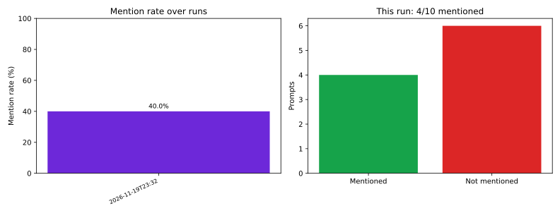
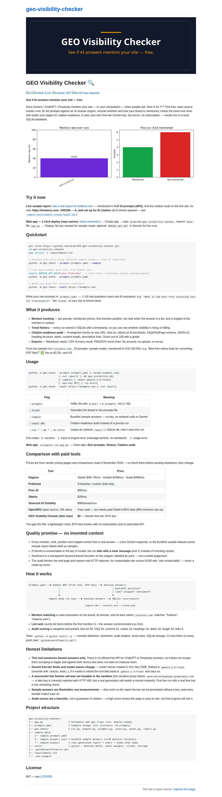

# GEO Visibility Checker 🔍

[](https://github.com/mrabr381/geo-visibility-checker/actions/workflows/ci.yml)
[](https://www.python.org/downloads/)
[](LICENSE)
[](#quickstart)
[](https://github.com/mrabr381/geo-visibility-checker) [](https://www.buymeacoffee.com/muhammadabubakar)

**See if AI answers mention your site — free.**

Does Gemini / ChatGPT / Perplexity mention your site — or your competitors — when people ask "best X for Y"? This free, open-source tracker runs 10–50 prompts against an AI answer engine, records whether and how your brand is mentioned, charts the trend over time, and audits your pages for citation-readiness. It uses your own free-tier Gemini key. No server, no subscription — results live in a local SQLite database.



## Try it now

**Live sample report:** [see a real report for toolenix.com](https://mrabr381.github.io/geo-visibility-checker/sample_data/sample_output/) — mentioned in **4 of 10 prompts (40%)**. And the citation audit on the live site, for real: **https://toolenix.com: 100/100 — A, well set up for AI citation** (all 8 checks passed — see [`sample_data/sample_output/audit.md`](sample_data/sample_output/audit.md)).



*Screenshot of the live site — hero, mention-rate trend chart for toolenix.com (4 of 10 prompts, 40%), and the full tool overview.*

**Web app — 1-click deploy (repo owner):** [share.streamlit.io](https://share.streamlit.io) → Create app → repo `mrabr381/geo-visibility-checker`, branch `main`, file `app.py` → Deploy. No key needed for sample mode; optional `GEMINI_API_KEY` in Secrets for live runs.

## Quickstart

```bash
git clone https://github.com/mrabr381/geo-visibility-checker.git
cd geo-visibility-checker
pip install -r requirements.txt

# Preview with zero setup (bundled sample answers, clearly labelled):
python -m geo_check --prompts prompts.yaml --sample

# Live measurement with your free Gemini key:
export GEMINI_API_KEY="your-free-key"   # from https://aistudio.google.com/app/apikey
python -m geo_check --prompts prompts.yaml

# Audit one page for citation-readiness:
python -m geo_check --audit https://example.com
```

Write your own prompts in `prompts.yaml` — 1–50 real questions users ask AI assistants, e.g. `"What is the best free invoicing tool for freelancers?"`. Set `brand:` to your site or brand name.

## What it produces

- **Mention tracking** — per prompt: mentioned yes/no, first-mention position, list rank when the answer is a list, and a snippet of the mention in context.
- **Trend history** — every run stored in SQLite with a timestamp, so you can see whether visibility is rising or falling.
- **Citation-readiness audit** — 8 weighted checks on any URL: llms.txt, robots.txt AI-bot blocks, FAQ/FAQPage schema, JSON-LD, heading structure, dates, content length, descriptive links. Score out of 100 with a grade.
- **Exports** — Markdown report, CSV of every result, PNG/SVG trend chart. No account, no upload, no server.

From the sample run (`toolenix.com`, 10 prompts, sample mode): mentioned in 4/10 (40.0%), e.g. "Best free online tools for converting PDF files?" ✅ Yes at 40.2%, rank #3.

## Usage

```
python -m geo_check --prompts prompts.yaml [--brand example.com]
                     [--out report] [--db geo_visibility.db]
                     [--sample] [--model gemini-2.0-flash]
                     [--api-key KEY] [--no-store]
python -m geo_check --audit https://example.com [--out report]
```

| Flag | Meaning |
|---|---|
| `--prompts` | YAML file with `brand:` + a `prompts:` list (1–50) |
| `--brand` | Overrides the brand in the prompts file |
| `--sample` | Bundled sample answers — no key, no network calls to Gemini |
| `--audit URL` | Citation-readiness audit instead of a prompt run |
| `--out` / `--db` / `--no-store` | Output dir (default `report`) / SQLite db / don't save this run |

Exit codes: `0` success · `1` input or engine error (message printed, no traceback) · `2` usage error.

**Web app:** `streamlit run app.py` — three tabs: **Run prompts**, **History**, **Citation audit**.

## Comparison with paid tools

Prices are from vendor pricing pages and comparisons read in November 2026 — re-check them before quoting elsewhere, they change.

| Tool | Price |
|---|---|
| **Dageno** | Starter $49–79/mo · Growth $199/mo · Scale $499/mo |
| **Profound** | Enterprise / custom (trial only) |
| **Peec AI** | $95/mo |
| **Otterly** | $29/mo |
| **Semrush AI Visibility** | $99/domain/mo |
| **OpenSEO** (open source, 25k stars) | Free code — but needs paid DataForSEO data ($50 minimum top-up) |
| **GEO Visibility Checker (this repo)** | **$0** — Gemini free tier, BYO key |

The gap this fills: a lightweight, local, BYO-key tracker with no subscription and no paid data API.

## Quality promise — no invented content

- Every mention, rank, position and snippet comes from a real answer — a live Gemini response, or the bundled sample dataset (every sample report labels itself as sample).
- If Gemini is unreachable or the key is invalid, the run **fails with a clear message** (exit 1) instead of inventing results.
- Sentiment is a transparent keyword-based heuristic on the snippet, labelled as such — not a model judgement.
- The audit fetches the real page and reports real HTTP statuses. An unreachable site scores 0/100 with "site unreachable" — never a made-up score.

## How it works

```
prompts.yaml ──▶ Gemini API (free tier, BYO key) ──▶ analyse_answer()
                     │                                     │ mention? position?
                     │                                     │ rank? snippet? sentiment?
                     ▼                                     ▼
              sample mode (no key) ──▶ bundled answers ──▶ SQLite runs/results
                                                              │
                                        report.md + results.csv + trend.png
```

- **Mention matching** is case-insensitive on the brand, its domain, and its bare name (`toolenix.com` matches "Toolenix", "toolenix.com").
- **List rank** counts list items before the first mention (1 = the answer recommended you first).
- **Audit scoring** is weighted and printed: llms.txt 20, FAQ 20, schema 15, robots 10, headings 10, dates 10, length 10, links 5.

Tests: `python -m pytest tests/ -q` — mention detection, sentiment, audit weights, trend rates, SQLite storage. CI runs them on every push (see `.github/workflows/ci.yml`).

## Honest limitations

- **This tool measures Gemini answers only.** There is no official free API for ChatGPT or Perplexity answers, so it does not scrape them (scraping is fragile and against their terms) and does not claim to measure them.
- **Gemini free-tier limits and model names change** — model names rotated in Oct–Nov 2026. Default is `gemini-2.0-flash` (override with `GEMINI_MODEL`); if a model is retired the tool falls back to `gemini-1.5-flash` and says so.
- **A successful live Gemini call was not testable in the sandbox** (the sandbox proxy blocks `generativelanguage.googleapis.com` — a fake key is correctly rejected with HTTP 400, but a real generation call needs a normal network). First live run with a real free key is the remaining check.
- **Sample answers are illustrative, not measurements** — they exist so the report format can be previewed without a key, and every sample output says so.
- **Audit scores are a heuristic**, not a guarantee of citation — a high score means the page is easy to cite, not that engines will cite it.

## Project structure

```
geo-visibility-checker/
├── app.py                  # Streamlit web app (repo root, deploy-ready)
├── prompts.yaml            # example prompt list (Toolenix, 10 prompts)
├── geo_check/              # cli.py, engine.py, prompts.py, store.py, audit.py, report.py
├── sample_data/
│   ├── sample_prompts.yaml
│   ├── sample_answers.json # bundled sample answers (4/10 mention Toolenix)
│   └── sample_output/      # real generated report + chart + index.html demo
├── tests/                  # pytest — mention maths, audit weights, trends, storage
├── .github/workflows/ci.yml
├── requirements.txt
└── .env.example
```

## License

MIT — see [LICENSE](LICENSE).
